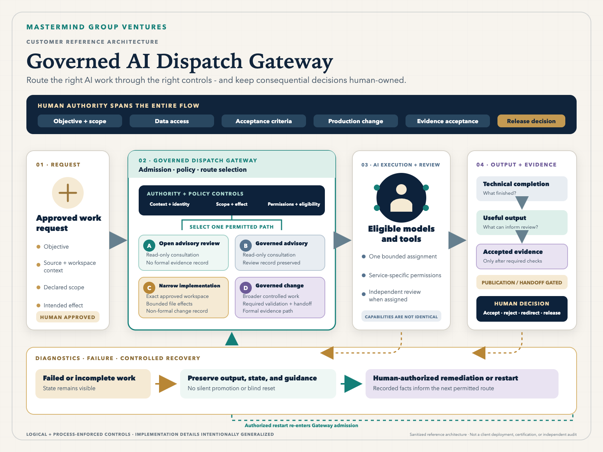

# Enterprise Integration & AI Systems Engineering

I lead architecture and delivery by making system dependencies, data boundaries, acceptance criteria, and operational ownership clear. This portfolio connects my enterprise integration background with current application and governed AI engineering work.

## Start with the evidence

| Area | What to examine | Evidence available |
| --- | --- | --- |
| Enterprise integration | [Contact-center integration and cloud access design](case-studies/enterprise-integration.md) | My published account of Capital One work across six acquired HSBC sites and Amazon Connect. |
| Application engineering | [DNA Health Insights](case-studies/dna-health-insights.md) | Live product and public descriptions of the data flow and delivery responsibilities. |
| Governed AI engineering | [Human-approved AI work](case-studies/human-approved-ai-work.md) | Internal Gateway architecture and a documented, reviewed local coding workflow. |
| Inspectable Python | [Connected Report Demo](https://github.com/adolphwhite7/connected-report-demo) | Source, synthetic inputs, output example, and runnable tests. |

[Evidence index: ownership, artifacts, verification, and limits](EVIDENCE.md)

## Enterprise Integration

My Capital One work included coordinating contact-center integration across networks, firewalls, desktops, and hardware, and working with cloud engineering and information security on Amazon Connect access controls. The case study explains the systems, cross-team dependencies, and operational design choices.

[Read the enterprise integration case study](case-studies/enterprise-integration.md)

## DNA Health Insights

A live consumer genomics education platform. Its public architecture processes raw DNA locally in the browser; with consent, structured findings support plain-language readings saved with reports in the signed-in account. My work spans architecture, customer experience, report creation, guided support, payments, dashboards, testing, and product ownership.

[Read the DNA Health Insights case study](case-studies/dna-health-insights.md)  
[Visit the live product](https://www.dna-health-insights.com/)

## Keeping AI Work Within Human-Approved Boundaries

MGV's internal governed AI Gateway separates read-only review, bounded code changes, evidence acceptance, and release authority. The public guide documents LangGraph workflow control, Git revision identity, route-specific permissions, and a locally demonstrated Codex change with independent Cline review.

[Read the Gateway case study](case-studies/human-approved-ai-work.md)

## Runnable Example

[Connected Report Demo](https://github.com/adolphwhite7/connected-report-demo) is a Python standard-library CLI that validates synthetic findings, preserves requested selection order, and produces a Markdown report with source links. It includes sample inputs, expected output, and seven unit tests.

## About

Created by [Adolph White Jr.](https://github.com/adolphwhite7), Chief Architect of DNA Health Insights and Founder of Mastermind Group Ventures.
